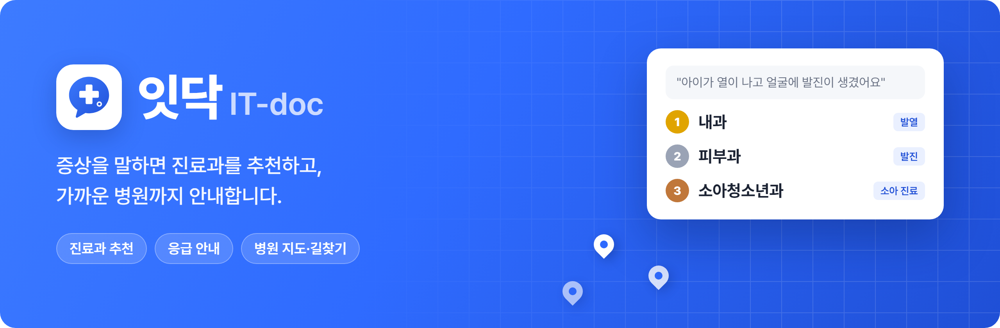
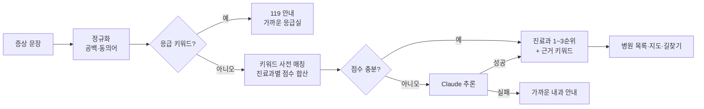

<p align="center"></p>

# 잇닥 (IT-doc)

증상을 문장으로 입력하면 갈 만한 진료과를 1~3순위로 추천하고, 근처 병원을 지도와 길찾기로 안내하는 웹 서비스입니다.

> 잇닥의 추천은 진단이 아닌 참고용 정보입니다.

| 기간 | 인원 | 담당 |
| :-- | :-- | :-- |
| 2026.06 (SSAFY 1학기 관통 프로젝트) | 2명 | 추천 엔진, AI 데이터 전처리, 공공데이터 적재, 백엔드 API, 프론트 화면 대부분 |

## 주요 기능

- **진료과 추천**: "목이 붓고 침 삼킬 때 아파요" 같은 문장에서 증상 키워드를 찾아 진료과 1~3순위와 근거 키워드를 보여줍니다.
- **응급 분기**: 가슴 통증, 호흡 곤란 같은 응급 신호가 있으면 추천보다 먼저 119 안내와 가까운 응급실 목록을 띄웁니다.
- **AI 보완 추천**: 키워드 사전으로 잡히지 않는 표현은 Claude가 진료과를 추론하고, 추론 근거를 함께 보여줍니다.
- **병원 안내**: 현재 위치 기준 거리순으로 병원을 보여주고, 영업 중인 곳과 후기 평점을 반영해 정렬합니다. 카카오맵 지도, 앱 안 길찾기, 전화 연결까지 한 화면에서 됩니다.
- **회원 기능**: 로그인하면 검색 이력이 건강 기록으로 남고, 추천이 맞았는지 평가한 결과가 키워드 가중치에 반영됩니다.

## 결과

**추천 정확도** (16개 진료과에 고르게 나눈 평가 문장 206개)

| | 키워드 사전만 | 사전 + AI |
| :-- | --: | --: |
| 1순위 적중 | 40.8% | 약 69% |
| 1~3순위 안에 정답 | 51.5% | **약 83%** |

- 사전으로 충분히 판단되는 54%는 AI를 부르지 않고 바로 처리하고, 나머지 46%만 AI가 보완합니다.
- AI 응답은 실행마다 조금씩 달라서 정수로 반올림했습니다. 평가 데이터는 `backend/api/data/eval_symptoms_v2.csv`에 있습니다.

**데이터**

- 증상 키워드 사전 5,253개 (직접 작성한 510개에 AI로 만들고 검수한 키워드를 더해 중복 제거)
- 구미·김천·칠곡 병·의원 554곳 (건강보험심사평가원 API), 응급의료기관 (E-Gen API)
- 진료과 16개, 심평원 진료과목 코드와 1:1로 맞춤

## 추천 흐름



## 구현하면서 고민한 것

**모든 요청을 LLM에 보내지 않은 이유**
AI만 썼을 때 1순위 적중률은 79.6%로 가장 높았습니다. 하지만 매 요청마다 비용과 지연이 생기고 외부 API가 죽으면 서비스도 멈춥니다. 그래서 흔한 증상은 키워드 사전으로 즉시 처리하고, 사전 점수가 낮을 때만 AI를 부르도록 나눴습니다. 응급 판단은 항상 사전 쪽에서 먼저 합니다.

**AI로 만든 키워드 사전 검수**
심평원 질병정보 API는 질병명과 질병 코드만 주고 증상은 주지 않습니다. 질병 2,065건을 Claude로 "환자가 실제로 쓰는 증상 표현 + 진료과"로 바꾼 뒤, 중복·목록 밖 진료과·응급 키워드와 겹치는 항목 589건을 자동으로 걸러내고 나머지는 사람이 검수했습니다. 적재 후에는 5,253개 전체를 서로 대조했습니다. "눈이 가렵고 분비물이 나와요"가 산부인과로 추천되는 식으로, 너무 일반적인 키워드가 다른 진료과 문장까지 끌고 가는 경우를 찾아 고쳤습니다.

**질병 API "서버 장애" 오진단**
질병정보 API가 결과 코드 99와 0건을 돌려줘서 서버 장애로 판단하고 작업을 멈췄습니다. 응답 원문을 직접 보니 서버는 정상이었고, 필수 파라미터가 빠져 있었습니다. 파라미터를 채운 뒤 질병 2,065건을 정상으로 받았습니다.

그 밖의 문제와 해결 과정은 [TROUBLESHOOTING.md](TROUBLESHOOTING.md)에 정리했습니다.

## 기술 스택

| 구분 | 기술 |
| :-- | :-- |
| Backend | Django 4.2, Django REST Framework, SimpleJWT, SQLite |
| Frontend | Vue 3 (Composition API), Pinia, Vue Router |
| 지도·길찾기 | 카카오맵 JavaScript SDK, 카카오모빌리티 길찾기 API (백엔드 프록시) |
| AI | Anthropic Claude (키워드 전처리, 추천 보완) |
| 공공데이터 | 건강보험심사평가원 병원정보·질병정보 API, E-Gen 응급의료기관 API |

## 실행 방법

### 백엔드 (http://127.0.0.1:8000)

```powershell
cd backend
python -m venv venv
.\venv\Scripts\Activate.ps1
pip install -r requirements.txt
copy .env.example .env           # 필요한 API 키 입력
python manage.py migrate
python manage.py seed_data       # 진료과, 키워드 사전, 응급 키워드, 데모 병원
python manage.py runserver
```

테스트: `python manage.py test api`

<details>
<summary>(선택) 심평원 실데이터 적재</summary>

공공데이터포털에서 **건강보험심사평가원_병원정보서비스**를 활용 신청한 뒤 실행합니다.

```powershell
python manage.py import_hira --key <일반인증키> --dry-run   # 미리보기
python manage.py import_hira --key <일반인증키>              # 적재 (데모 병원 대체)
# 옵션: --regions 구미시,김천시,칠곡군  --sido-cd 370000  --probe-sido
```

- 진료과목 코드로 역조회해서 병원과 진료과의 다대다 관계를 상세 API 없이 만듭니다.
- 치과는 세부 과목 코드(50~61)까지 조회합니다.
- 진료시간을 신고하지 않은 곳은 09:00~18:00 기본값을 씁니다.

</details>

### 프론트엔드 (http://localhost:5173)

```powershell
cd frontend
npm install
copy .env.example .env           # VITE_KAKAO_JS_KEY 입력
npm run dev
```

카카오 키는 [Kakao Developers](https://developers.kakao.com)에서 앱을 만든 뒤 JavaScript 키를 복사하고, 플랫폼에 `http://localhost:5173`을 등록하면 됩니다.

키워드 사전, 응급 키워드, 병원 데이터는 Django Admin(`/admin/`)에서 관리합니다. 관리자 계정은 `python manage.py createsuperuser`로 만듭니다.

## API

<details>
<summary>API 목록</summary>

| Method | URL | 설명 |
|---|---|---|
| POST | `/api/recommend/` | 증상 문장 → 응급 분기 또는 진료과 1~3순위 (로그인 시 검색 이력 저장) |
| GET | `/api/departments/` | 진료과 목록 |
| GET | `/api/hospitals/?lat=&lng=&department_id=&radius=&open_only=` | 위치·진료과 기준 병원 목록 (결과가 없으면 반경을 3km에서 최대 20km까지 확장) |
| GET | `/api/hospitals/<id>/` | 병원 상세 (좌표, 진료시간, 후기 평점) |
| GET·POST | `/api/hospitals/<id>/reviews/` | 후기 목록 / 작성·수정 (로그인 필요, 병원당 1개) |
| DELETE | `/api/reviews/<id>/` | 내 후기 삭제 |
| GET | `/api/emergency-centers/?lat=&lng=` | 가까운 응급의료기관 거리순 |
| GET | `/api/directions/?origin_lat=&origin_lng=&dest_lat=&dest_lng=` | 자동차 길찾기 (경로 좌표, 거리, 소요시간) |
| POST | `/api/auth/signup/` · `/api/auth/login/` · `/api/auth/refresh/` | 회원가입 / 로그인 / 토큰 갱신 |
| GET | `/api/auth/me/` | 내 정보, 건강 기록 요약, 최근 검색 이력 |
| DELETE | `/api/auth/logs/<id>/` | 건강 기록 삭제 |
| POST | `/api/auth/logs/<id>/feedback/` | 추천 평가 (키워드 가중치 보정에 반영) |

</details>

<details>
<summary><code>POST /api/recommend/</code> 응답 예시</summary>

```json
// 일반
{"emergency": false, "results": [{"department_id": 2, "department": "이비인후과", "score": 6, "matched_keywords": ["콧물", "인후통"]}], "fallback": false}

// 응급 (keyword: 매칭된 어간, label: 화면 표시용 증상명)
{"emergency": true, "matched_keywords": [{"keyword": "가슴통증", "label": "가슴 통증", "category": "심혈관계"}], "message": "응급 상황일 수 있습니다. 즉시 119에 연락하세요."}

// AI 추론 (사전 매칭 0건)
{"emergency": false, "source": "ai", "results": [{"department_id": 5, "department": "안과", "score": null, "matched_keywords": [], "ai_reason": "복시·초점 조절 장애는 눈의 질환 가능성", "confidence": 0.8}]}

// 폴백 (추천 실패)
{"emergency": false, "results": [], "fallback": true, "message": "정확한 추천이 어렵습니다. 가까운 내과를 먼저 방문해 보세요."}
```

</details>

## 남은 과제

발표 기간에는 노트북과 임시 터널로 운영했고, 정식 배포는 하지 않았습니다. 배포한다면 프론트는 정적 호스팅(Cloudflare Pages, Vercel), 백엔드는 Railway·Render 같은 서비스, DB는 PostgreSQL로 옮길 계획입니다. 위치 정보는 HTTPS에서만 동작하고 카카오맵은 도메인 등록이 필요해서, 배포 도메인이 정해지면 함께 설정해야 합니다.

## 문서

- [TROUBLESHOOTING.md](TROUBLESHOOTING.md): 문제와 해결 기록
- [PRESENTATION.md](PRESENTATION.md): 발표 자료와 정확도 평가 상세
- [SCRUM.md](SCRUM.md): 진행 기록
